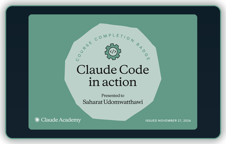
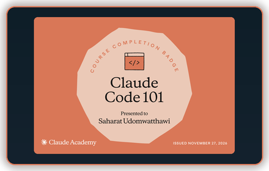
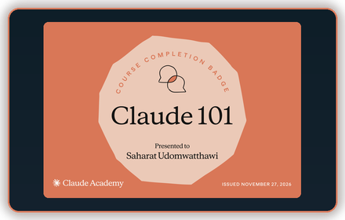

### Saharat Udomwatthawi

CS @ Thammasat University.
[YouTube](https://www.youtube.com/@LDuckxy) (1.5M+ views, 10K+ subscribers).

**Projects**
- [stardew-ai-agent](https://github.com/duckxy166/stardew-ai-agent): an MCP server that runs inside Stardew Valley, so Claude, GPT and Gemini can farm the same save in split-screen
- [among-us-ai](https://github.com/duckxy166/among-us-ai): Claude, GPT, Gemini, DeepSeek, Kimi and Grok play an Among Us-style game with separate memories and secret thoughts

**University projects**
- [perimeter](https://github.com/PhurinKaewpuangsek/perimeter): indoor map and navigation for our faculty building, with room search and class schedules, serverless on AWS
- [validmate](https://github.com/PhurinKaewpuangsek/validmate): lab management and automatic grading for CS332/CS232, built on AWS
- [CS373_CourseTimetablingLab](https://github.com/Micosz/CS373_CourseTimetablingLab): compares four course timetabling algorithms in the browser

**Certifications & Training**

<table>
  <tr>
    <td width="230"></td>
    <td>
      <b>AWS Academy Graduate - Cloud Architecting</b> 
      <i>Amazon Web Services Training and Certification</i> 
      Designing AWS architectures for availability, scale and security: VPC networking, load balancing and Auto Scaling, databases, caching, decoupling and serverless, guided by the Well-Architected Framework. 60 hours, Nov 2026. 
      <a href="https://www.credly.com/badges/4e51d107-0cae-4818-b6e2-40a0bc50d2d0/public_url">Verify on Credly ↗</a>
    </td>
  </tr>
  <tr>
    <td width="230"></td>
    <td>
      <b>AWS Academy Graduate - Cloud Foundations</b> 
      <i>Amazon Web Services Training and Certification</i> 
      AWS Cloud concepts, core services, security, architecture, pricing and support. 
      <a href="https://www.credly.com/badges/d69df772-acb4-4c0b-8f17-b6a32e9516f9/public_url">Verify on Credly ↗</a>
    </td>
  </tr>
  <tr>
    <td width="230"></td>
    <td>
      <b>Claude Code in Action</b> 
      <i>Anthropic, Claude Academy</i> 
      Running long, hands-off Claude Code sessions that can be trusted: steering, configuration, automation and verification. Nov 2026. 
      <a href="https://academy.claude.com/verify/df9b9994f26fd111f3c721240efca655">Verify on Claude Academy ↗</a>
    </td>
  </tr>
  <tr>
    <td width="230"></td>
    <td>
      <b>Claude Code 101</b> 
      <i>Anthropic, Claude Academy</i> 
      Using Claude Code on a real codebase: CLAUDE.md project context, subagents, MCP servers and hooks. Nov 2026. 
      <a href="https://academy.claude.com/verify/57a71d18bb0fddac1b4a096101c073ed">Verify on Claude Academy ↗</a>
    </td>
  </tr>
  <tr>
    <td width="230"></td>
    <td>
      <b>Claude 101</b> 
      <i>Anthropic, Claude Academy</i> 
      Everyday work with Claude: effective prompting, projects, artifacts, skills and connected tools. Nov 2026. 
      <a href="https://academy.claude.com/verify/55d0bdb4453ccdc15f3048504287c64c">Verify on Claude Academy ↗</a>
    </td>
  </tr>
  <tr>
    <td width="230"></td>
    <td>
      <b>Inbound Sales Certified</b> 
      <i>HubSpot Academy</i> 
      Inbound sales methodology: understanding the buyer's context, prioritizing active buyers, earning attention and delivering personalized sales presentations. 
      <a href="https://app-na2.hubspot.com/academy/achievements/9h1s4qq3/en/1/saharat-udomwatthawi/inbound-sales-certified">Verify on HubSpot Academy ↗</a>
    </td>
  </tr>
</table>
